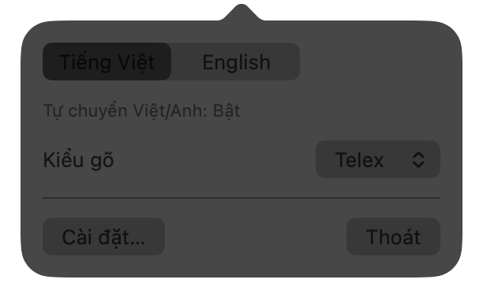
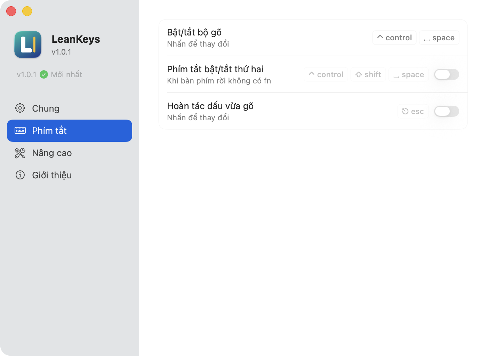
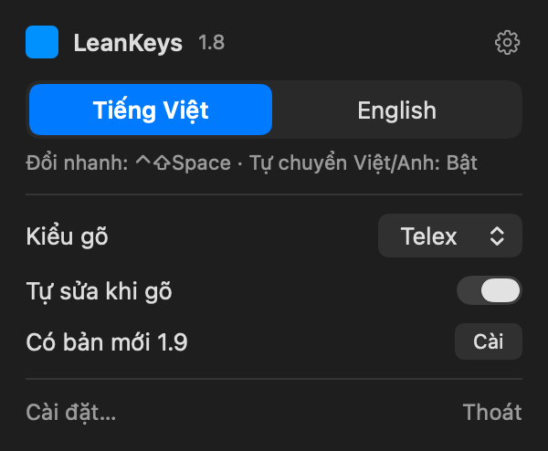

<h1 align="center">
  <br>
  LeanKeys
</h1>

<p align="center">
  <strong>Bộ gõ tiếng Việt cho macOS: cài xong là gõ.</strong><br>
  Tự chuyển Việt/Anh khi bạn gõ lẫn hai thứ tiếng. Không cần chọn engine, không cần chỉnh gì.
</p>

<p align="center">
  
  
  
</p>

<p align="center">
  
</p>

## Con lai của ba bộ gõ mã nguồn mở

LeanKeys gom những phần tốt nhất của ba bộ gõ tiếng Việt mã nguồn mở vào một app:

| Từ | LeanKeys lấy gì |
| --- | --- |
| [**Gõ Nhanh**](https://github.com/khaphanspace/gonhanh.org) | Thân app macOS: xử lý phím ổn định trên Chrome, Spotlight, IDE và Terminal, sửa lỗi theo từng app, gõ tắt, cài đặt, tự cập nhật. Engine Telex/VNI viết bằng Rust. |
| [**Vikey**](https://github.com/tonyminibot/Vikey) | Engine mặc định: **tự chuyển Việt/Anh theo ngữ cảnh**, và **⌫⌫** để trả lại đúng các phím bạn đã gõ khi nó đoán sai. |
| [**OpenKey**](https://github.com/tuyenvm/OpenKey) | Nền móng của engine Vikey. |

LeanKeys là bản fork của Gõ Nhanh. Mã gốc giữ nguyên; mọi chỗ LeanKeys sửa đều được đánh dấu `LEANKEYS-HOOK`. Nhờ vậy mỗi đêm LeanKeys tự kéo bản mới của Gõ Nhanh và Vikey về, chạy toàn bộ test, rồi build sẵn bản mới.

## Tính năng

- **Gõ xen Việt/Anh không cần bấm phím chuyển.** `deploy leen server rooif check log nhes` ra *deploy lên server rồi check log nhé*. Đoán sai thì bấm ⌫⌫ để lấy lại đúng các phím đã gõ.
- **Tự chọn engine.** Mặc định dùng Vikey. Khi bạn gõ VNI, hoặc khi Vikey không khởi động được, LeanKeys tự chuyển sang engine Gõ Nhanh.
- **Ô nổi trên menu bar.** Bấm icon để đổi Tiếng Việt/English, đổi kiểu gõ, xem cảnh báo khi một app đang chặn gõ (Secure Input), cài bản mới. Bấm phải vẫn mở menu đầy đủ.
- **Icon V/E đổi mượt** mỗi khi LeanKeys tự chuyển ngôn ngữ, và không có hiệu ứng nếu bạn bật "Giảm chuyển động".
- **Cấp quyền Trợ năng chỉ một lần.** Bấm một nút rồi gạt một công tắc. Quyền được giữ qua các bản cập nhật.
- **Tự cập nhật an toàn.** Kiểm tra chữ ký của bản mới trước khi cài. Chỉ cài ngầm khi bản mới có cùng chữ ký với bản đang chạy; nếu không, chờ bạn bấm "Cài bản mới".
- Telex và VNI, gõ tắt, đặt dấu kiểu mới (`oà`), nhớ Việt/Anh theo từng app, khởi động cùng máy.

## Ảnh chụp

| Cài đặt · Chung | Cài đặt · Phím tắt |
| --- | --- |
|  |  |
| **Cài đặt · Nâng cao** | **Cài đặt · Giới thiệu** |
|  |  |

| Ô nổi (chế độ tối) | Khi một app đang chặn gõ |
| --- | --- |
|  |  |

## Tải về và cài đặt

1. Tải `LeanKeys-x.y.dmg` mới nhất ở trang [Releases](https://github.com/anlvdt/LeanKeys/releases), mở file và kéo `LeanKeys.app` vào thư mục Applications.
2. LeanKeys chưa được Apple công chứng, nên lần đầu macOS có thể báo app "bị hỏng" hoặc "không xác định được nhà phát triển". Mở Terminal, chạy lệnh dưới đây rồi mở lại app:

   ```sh
   xattr -cr /Applications/LeanKeys.app
   ```

3. Bấm **Cấp quyền Trợ năng** trên màn chào, rồi gạt công tắc **LeanKeys** trong danh sách. LeanKeys tự khởi động lại và bạn gõ được ngay.

Đừng chạy LeanKeys cùng lúc với một bộ gõ khác (Gõ Nhanh, Vikey, OpenKey, EVKey…): hai bộ gõ sẽ cùng xử lý phím.

**Nếu bạn từng dùng bản LeanKeys ký ad-hoc:** lần cập nhật đầu lên bản ký bằng chứng chỉ, LeanKeys tự xoá mục quyền cũ của chính nó; bạn chỉ cần gạt lại công tắc một lần. Từ đó về sau không phải cấp lại nữa.

## Tự build

Cần Xcode và Rust (`rustup`).

```sh
leankeys/build.sh --version 1.0          # ra dist/LeanKeys.app
leankeys/build.sh --version 1.0 --dmg    # thêm dist/LeanKeys-1.0.dmg
```

`build.sh` ký app theo thứ tự ưu tiên:
1. Developer ID, nếu có biến môi trường `LEANKEYS_SIGN_IDENTITY` và `LEANKEYS_NOTARY_PROFILE`.
2. Chứng chỉ tự cấp `LeanKeys Self-Signed`, nếu có trong Keychain. Tạo một lần bằng `sync/make-signing-cert.sh`.
3. Ký ad-hoc.

Chỉ bản ký bằng chứng chỉ cố định mới giữ được quyền Trợ năng qua các lần cập nhật.

## Phát triển

Bật cổng test trước khi push (mỗi bản clone một lần):

```sh
git config core.hooksPath .githooks
```

Từ đó mỗi `git push` chạy `.githooks/pre-push`, gồm:
- `cargo test` trong `core/`;
- `swift test`;
- test engine Vikey;
- `sync/check-divergence.sh`;
- test của `sync/`.

Chạy tay `.githooks/pre-push --all` để thêm bản build Release.

- **Đồng bộ với repo gốc:** `sync/install-launchd.sh` cài một job chạy lúc 3 giờ sáng mỗi ngày. Job kéo release mới của Gõ Nhanh và Vikey, chạy test, build sẵn bản mới. Nó không bao giờ tự phát hành.
- **Đăng bản:** chạy `sync/release.sh --dry-run` để xem trước, rồi `sync/release.sh`. Danh sách thử tay trước khi đăng nằm trong `sync/manual-checklist.md`.
- **Thiết kế:** [docs/superpowers/specs/2026-11-15-leankeys-design.md](../docs/superpowers/specs/2026-11-15-leankeys-design.md).

## Ghi công

LeanKeys đứng trên vai ba dự án mã nguồn mở. Cảm ơn các tác giả và cộng đồng của họ.

- [Gõ Nhanh](https://github.com/khaphanspace/gonhanh.org): khaphanspace và cộng đồng Gõ Nhanh, BSD-3-Clause.
- [Vikey](https://github.com/tonyminibot/Vikey): Tony Dinh, GPL-3.0.
- [OpenKey](https://github.com/tuyenvm/OpenKey): Mai Vũ Tuyên, GPL-3.0.

Chi tiết trong [ACKNOWLEDGEMENTS.md](../ACKNOWLEDGEMENTS.md). LeanKeys là dự án độc lập, không liên kết với ba dự án trên và không dùng tên hay logo của họ làm thương hiệu.

## Giấy phép

LeanKeys phát hành theo [GPL-3.0](../LICENSE). Phần mã của Gõ Nhanh giữ giấy phép BSD-3-Clause gốc ([LICENSES/gonhanh-BSD-3.txt](../LICENSES/gonhanh-BSD-3.txt)).
