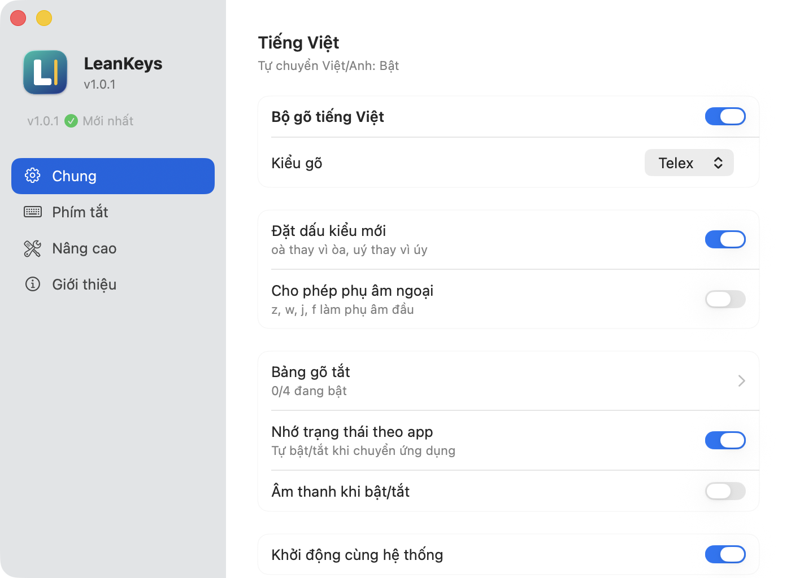
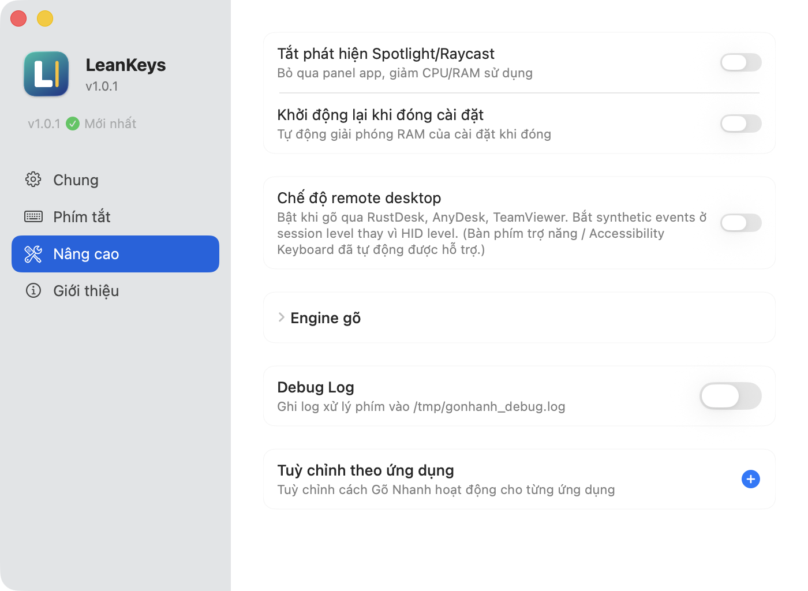
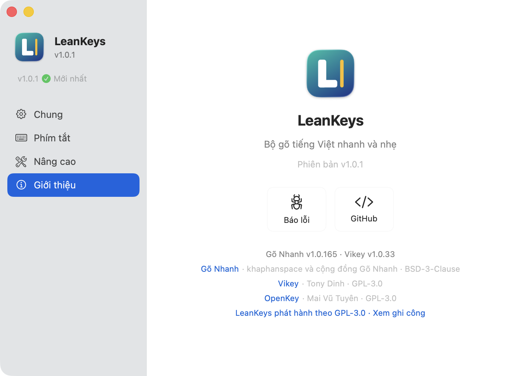
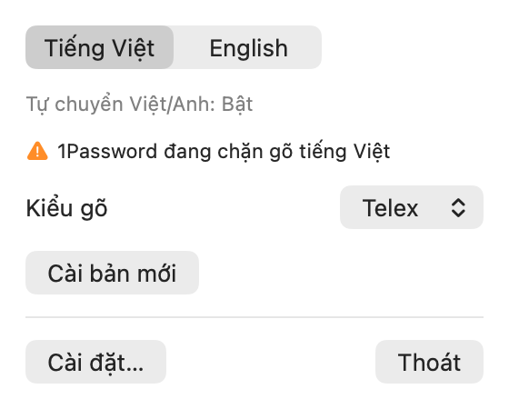

<h1 align="center">
  <br>
  LeanKeys
</h1>

<p align="center">
  <strong>Bộ gõ tiếng Việt cho macOS: cài xong là gõ.</strong><br>
  Dùng lõi gõ của Gõ Nhanh và Vikey, thêm tự học, tự viết hoa tên riêng và không bao giờ đụng tới mật khẩu.
</p>

<p align="center">
  
  
  
</p>

<p align="center">
  
</p>

## Lõi gõ lấy từ đâu

LeanKeys không viết lại bộ gõ từ đầu. Phần đoán chữ dùng nguyên lõi của hai bộ gõ mã nguồn mở đã được nhiều người dùng:

| Dự án | LeanKeys dùng phần nào |
| --- | --- |
| [**Gõ Nhanh**](https://github.com/khaphanspace/gonhanh.org) | Thân app macOS và engine Telex/VNI viết bằng Rust: cách gửi phím ổn định trên Chrome, Spotlight, IDE; sửa lỗi theo từng app; bảng gõ tắt; cài đặt. |
| [**Vikey**](https://github.com/tonyminibot/Vikey) | Engine mặc định: **tự chuyển Việt/Anh theo ngữ cảnh**, nhận ra code, và **⌫⌫** để trả lại đúng các phím đã gõ khi nó đoán sai. |
| [**OpenKey**](https://github.com/tuyenvm/OpenKey) | Nền móng của engine Vikey. |

LeanKeys là bản fork của Gõ Nhanh. Mã gốc của hai lõi được giữ nguyên, nên cách bỏ dấu, tự chuyển Việt/Anh và ⌫⌫ giống hệt khi bạn dùng Gõ Nhanh hay Vikey.

## LeanKeys khác gì

Phần dưới đây là những gì LeanKeys tự làm thêm quanh hai lõi đó. Bạn sẽ không có chúng khi dùng riêng Gõ Nhanh hay Vikey.

### Gõ thông minh hơn, học từ chính bạn

- **Tự chọn lõi gõ.** Mặc định dùng Vikey. Khi bạn gõ VNI, hoặc khi Vikey không khởi động được, LeanKeys tự chuyển sang lõi Gõ Nhanh, không cần vào cài đặt.
- **Gõ đúp phím dấu rồi ⌫ không còn hỏng từ.** Với Vikey gốc, gõ `hocjj` rồi ⌫ sẽ thành chữ thô và chuyển sang tiếng Anh giữa chừng. LeanKeys trả lại "học". Trên kho 20.676 từ tin nhắn, tỉ lệ từ tiếng Việt bị hỏng ở lỗi này giảm từ 28,6% xuống 0,95%.
- **⌃⌫ đổi từ vừa gõ Việt ⇄ Anh.** Khi bộ gõ chọn sai ngôn ngữ cho một từ, bấm ⌃⌫ (Control + Delete) ngay sau từ đó: "có" thành `cos`, "bể" thành `beer`, `cos` thành "có". Dấu cách và dấu câu phía sau giữ nguyên; bấm ⌃⌫ lần nữa để đổi lại. Đây là loại lỗi ⌫⌫ không cứu được, vì Vikey để nguyên từ chứ không tự sửa. Trên kho 20.676 từ tin nhắn, bấm ⌃⌫ ở mỗi từ sai đưa số từ sai từ 41 xuống 13, và không làm sai từ nào đang đúng. Đổi phím ở Cài đặt › Phím tắt.
- **Tự học từ ⌫⌫ và ⌃⌫** (tắt sẵn, bạn tự bật). Khi bạn bật tính năng này và bấm ⌫⌫ để giữ nguyên một từ bị tự đổi (`cos`, `car`, `been`…), hay bấm ⌃⌫ để đổi một từ bị chọn sai, LeanKeys nhớ lại cả chiều đổi. Từ đó thường xuất hiện sau từ nào thì lần sau gặp đúng chỗ ấy nó ra đúng ngay; sau hai lần sửa thì đúng ở mọi nơi. Bấm ⌃⌫ hay ⌫⌫ ngay sau một lần LeanKeys tự đổi theo luật để đổi ý. Danh sách nằm ở Cài đặt › Nâng cao › Từ đã học.
- **Từ của tôi.** Dán sẵn một danh sách từ luôn giữ như gõ (tên sản phẩm, viết tắt, tên riêng tiếng Anh) bằng nút "Thêm từ giữ nguyên…": gõ xong từ là ra đúng chữ đã dán (`mix` không còn thành "mĩ").
- **⌫⌫ để sửa chữ cuối không còn hỏng từ tiếng Anh.** Gõ `test`, Space trả về "test", rồi ⌫⌫ để sửa chữ cuối: Vikey gốc hiểu đó là hoàn tác và ra "tétt". LeanKeys hiểu ⌫⌫ rồi gõ chữ là sửa từ, còn ⌫⌫ rồi phím ngắt vẫn là hoàn tác.
- **Gõ được địa danh Tây Nguyên.** Đắk Lắk, Đăk Lăk, Krông Búk, Krông Pắc, Cư M'gar, Đắk R'Lấp… ra đúng, kể cả khi gõ dấu sau chữ k (`Ddawks`).
- **Tự viết hoa tên riêng.** `tooi owr haf nooij` ra "tôi ở Hà Nội", `nguyeenx vawn an` ra "Nguyễn Văn An". LeanKeys học thêm những tên bạn tự viết hoa từ hai lần trở lên. Bấm ⌫ ngay sau khi viết hoa sai thì chữ trở về thường, và LeanKeys nhớ điều đó.
- **Bỏ phím lỡ bấm cùng Enter.** Một `\` hay `]` gõ dính ngay trước Enter trong ô chat được bỏ đi, không bị gửi kèm tin nhắn.
- **Gợi ý gõ tắt** (tắt sẵn, bạn tự bật). Cụm bạn gõ lại từ 3 lần trong 30 ngày, như địa chỉ, số điện thoại, mã số thuế, được gợi ý thành gõ tắt; bạn bấm Thêm hoặc Bỏ qua.
- **Gõ tắt chạy với cả lõi Vikey**, theo đúng quy tắc chữ hoa của Gõ Nhanh: `vn` → "Việt Nam", `VN` → "VIỆT NAM".

Các tính năng học và viết hoa chỉ chạy với lõi Vikey (chế độ "Tự động", mặc định).

### Không đụng tới mật khẩu và tài khoản

- **Ô đăng nhập: phím đi thẳng.** Ngoài ô mật khẩu thật, LeanKeys nhận ra cả ô email, tên đăng nhập, số điện thoại, mã OTP, mã xác thực (tiếng Việt và tiếng Anh), kể cả trong app Electron và form có nhãn rời. Ở đó mọi phím đi thẳng, nên `nguyenvana` không thành "nguyễnvana".
- **Trình quản lý mật khẩu và hộp thoại đăng nhập của macOS** (1Password, Bitwarden, KeePassXC, Passwords…): mọi phím đi thẳng ở mọi ô.
- **Terminal mặc định không gõ tiếng Việt** (Terminal, iTerm2, Warp, Ghostty, kitty, WezTerm…). Mật khẩu `sudo`, `ssh`, `git` gõ ở đó không có ô bảo mật, nên LeanKeys để nguyên mọi phím. Cần gõ tiếng Việt với agent CLI (Claude Code, Codex…)? Bật cho từng terminal ở Cài đặt › Nâng cao › "Gõ tiếng Việt trong terminal". Khi đã bật, mật khẩu gõ ở đó cũng bị bỏ dấu như chữ thường, nên hãy chuyển sang English trước khi gõ mật khẩu. Thứ gõ trong terminal vẫn không bao giờ được học.
- **Điều khiển từ xa và máy ảo** (UltraViewer/MacViewer, TeamViewer, AnyDesk, Windows App, Parsec, DeskIn, Citrix, VMware, Parallels, UTM…): phím đi thẳng, để bộ gõ bên máy kia xử lý, không bị bỏ dấu hai lần.
- **Không bao giờ học mật khẩu.** Không học trong ô đăng nhập, terminal, trình soạn code và trình quản lý mật khẩu. Từ trông như mật khẩu (trộn chữ với số hay ký hiệu) không bao giờ được lưu.
- **Dữ liệu học chỉ nằm trên máy.** Mọi thứ được mã hoá AES-GCM và không gửi đi đâu. Khoá nằm trong tệp riêng (quyền 0600) cạnh dữ liệu, trong thư mục chỉ tài khoản của bạn đọc được. Vì khoá ở cùng chỗ, mã hoá không che dữ liệu trước chương trình khác chạy dưới tài khoản của bạn hay trước bản sao lưu (Time Machine). Cụm chưa đủ số lần chỉ được lưu dưới dạng mã băm, không lưu chữ. Mỗi danh sách có nút "Xoá tất cả".
- **Nhật ký gỡ lỗi không chứa chữ bạn gõ.** Chỉ ghi độ dài và phím điều khiển. Tệp nằm trong thư mục riêng của bạn (Gõ Nhanh gốc ghi vào `/tmp`, nơi chương trình khác trên máy đọc được), và tự tắt sau 24 giờ.
- **App bật hardened runtime**, nên chương trình khác không thể chèn mã vào LeanKeys để mượn quyền Trợ năng.

### Cài xong là gõ

- **Cấp quyền Trợ năng chỉ một lần.** Bấm một nút trên màn chào rồi gạt một công tắc. App được ký bằng chứng chỉ cố định, nên quyền này còn nguyên qua mọi bản cập nhật.
- **Tự cập nhật an toàn.** Bản mới chỉ được cài khi đã qua kiểm tra: tải từ GitHub qua HTTPS, có số phiên bản lớn hơn, ký cùng chứng chỉ với bản đang chạy. App chờ máy rảnh 30 giây mới cài, không bao giờ cài giữa lúc bạn đang gõ.
- **Ô nổi trên thanh menu.** Bấm icon để đổi Tiếng Việt/English, đổi kiểu gõ, kiểm tra và cài bản mới, xem cảnh báo khi một app đang chặn gõ (Secure Input). Bấm phải vẫn mở menu đầy đủ.
- **Icon V/E đổi mượt** mỗi khi LeanKeys tự chuyển ngôn ngữ; không có hiệu ứng nếu bạn bật "Giảm chuyển động".
- **Cài đặt gọn bốn trang, chữ tiếng Việt thống nhất**, có nhãn cho VoiceOver. Mọi cài đặt hiện ra đều có tác dụng.

### Luôn theo kịp hai lõi gốc

Mọi chỗ LeanKeys sửa trong mã của Gõ Nhanh đều được đánh dấu `LEANKEYS-HOOK`, và một kiểm tra tự động chặn mọi sửa đổi không được đánh dấu. Nhờ vậy LeanKeys có thể kéo bản mới của Gõ Nhanh và Vikey về, chạy toàn bộ test, rồi build sẵn bản mới, mà không phải sửa tay lại từ đầu.

## Giữ nguyên từ Gõ Nhanh và Vikey

- Telex và VNI, đặt dấu kiểu mới (`oà`) hoặc kiểu cũ.
- Tự chuyển Việt/Anh theo ngữ cảnh, ⌫⌫ để lấy lại phím đã gõ (Vikey).
- Bảng gõ tắt, nhớ Việt/Anh theo từng app, tuỳ chỉnh cách gửi phím theo từng app, khởi động cùng máy (Gõ Nhanh).

**Đánh đổi cần biết:** terminal nằm trong trình soạn code (như terminal của VS Code) vẫn gõ tiếng Việt, vì LeanKeys không phân biệt được nó với phần soạn thảo. Khi gõ mật khẩu ở đó, hãy chuyển sang English trước.

## Ảnh chụp

| Cài đặt · Chung | Cài đặt · Phím tắt |
| --- | --- |
|  |  |
| **Cài đặt · Nâng cao** | **Cài đặt · Giới thiệu** |
|  |  |

| Ô nổi (chế độ tối) | Khi một app đang chặn gõ |
| --- | --- |
|  |  |

## Tải về và cài đặt

1. Tải `LeanKeys-x.y.dmg` mới nhất ở trang [Releases](https://github.com/anlvdt/LeanKeys/releases), mở file và kéo `LeanKeys.app` vào thư mục Applications.
2. LeanKeys chưa được Apple công chứng, nên lần đầu macOS có thể báo app "bị hỏng" hoặc "không xác định được nhà phát triển". Mở Terminal, chạy lệnh dưới đây rồi mở lại app:

   ```sh
   xattr -cr /Applications/LeanKeys.app
   ```

3. Bấm **Cấp quyền Trợ năng** trên màn chào, rồi gạt công tắc **LeanKeys** trong danh sách. LeanKeys tự khởi động lại và bạn gõ được ngay.

Đừng chạy LeanKeys cùng lúc với một bộ gõ khác (Gõ Nhanh, Vikey, OpenKey, EVKey…): hai bộ gõ sẽ cùng xử lý phím.

**Nếu bạn từng dùng bản LeanKeys ký ad-hoc:** lần cập nhật đầu lên bản ký bằng chứng chỉ, LeanKeys tự xoá mục quyền cũ của chính nó; bạn chỉ cần gạt lại công tắc một lần. Từ đó về sau không phải cấp lại nữa.

## Tự build

Cần Xcode và Rust (`rustup`).

```sh
leankeys/build.sh --version 1.0          # ra dist/LeanKeys.app
leankeys/build.sh --version 1.0 --dmg    # thêm dist/LeanKeys-1.0.dmg
```

`build.sh` ký app theo thứ tự ưu tiên:
1. Developer ID, nếu có biến môi trường `LEANKEYS_SIGN_IDENTITY` và `LEANKEYS_NOTARY_PROFILE`.
2. Chứng chỉ tự cấp `LeanKeys Self-Signed`, nếu có trong Keychain. Tạo một lần bằng `sync/make-signing-cert.sh`.
3. Ký ad-hoc.

Chỉ bản ký bằng chứng chỉ cố định mới giữ được quyền Trợ năng qua các lần cập nhật.

## Phát triển

Bật cổng test trước khi push (mỗi bản clone một lần):

```sh
git config core.hooksPath .githooks
```

Từ đó mỗi `git push` chạy `.githooks/pre-push`, gồm:
- `cargo test` trong `core/`;
- `swift test`;
- test engine Vikey;
- `sync/check-divergence.sh`;
- test của `sync/`.

Chạy tay `.githooks/pre-push --all` để thêm bản build Release.

- **Đồng bộ với repo gốc:** `sync/install-launchd.sh` cài một job chạy lúc 3 giờ sáng mỗi ngày. Job kéo release mới của Gõ Nhanh và Vikey, chạy test, build sẵn bản mới. Nó không bao giờ tự phát hành.
- **Đăng bản:** chạy `sync/release.sh --dry-run` để xem trước, rồi `sync/release.sh`. Danh sách thử tay trước khi đăng nằm trong `sync/manual-checklist.md`.
- **Đo gõ trộn Việt/Anh:** `tools/mixbench` gõ mô phỏng qua engine thật và đếm từ sai, gồm cả kiểu chat (kết thúc bằng Return, mang trạng thái sang câu sau, ⌫⌫ ngay sau Space) và phím ⌃⌫ (`--convert-wrong`, `--learn`). Cách chạy và số liệu trong [tools/mixbench/README.md](../tools/mixbench/README.md).
- **Thiết kế:** [docs/superpowers/specs/2026-11-15-leankeys-design.md](../docs/superpowers/specs/2026-11-15-leankeys-design.md); phím ⌃⌫: [docs/superpowers/specs/2026-11-28-convert-last-word-design.md](../docs/superpowers/specs/2026-11-28-convert-last-word-design.md).

## Ghi công

LeanKeys đứng trên vai ba dự án mã nguồn mở. Cảm ơn các tác giả và cộng đồng của họ.

- [Gõ Nhanh](https://github.com/khaphanspace/gonhanh.org): khaphanspace và cộng đồng Gõ Nhanh, BSD-3-Clause.
- [Vikey](https://github.com/tonyminibot/Vikey): Tony Dinh, GPL-3.0.
- [OpenKey](https://github.com/tuyenvm/OpenKey): Mai Vũ Tuyên, GPL-3.0.

Chi tiết trong [ACKNOWLEDGEMENTS.md](../ACKNOWLEDGEMENTS.md). LeanKeys là dự án độc lập, không liên kết với ba dự án trên và không dùng tên hay logo của họ làm thương hiệu.

## Giấy phép

LeanKeys phát hành theo [GPL-3.0](../LICENSE). Phần mã của Gõ Nhanh giữ giấy phép BSD-3-Clause gốc ([LICENSES/gonhanh-BSD-3.txt](../LICENSES/gonhanh-BSD-3.txt)).
